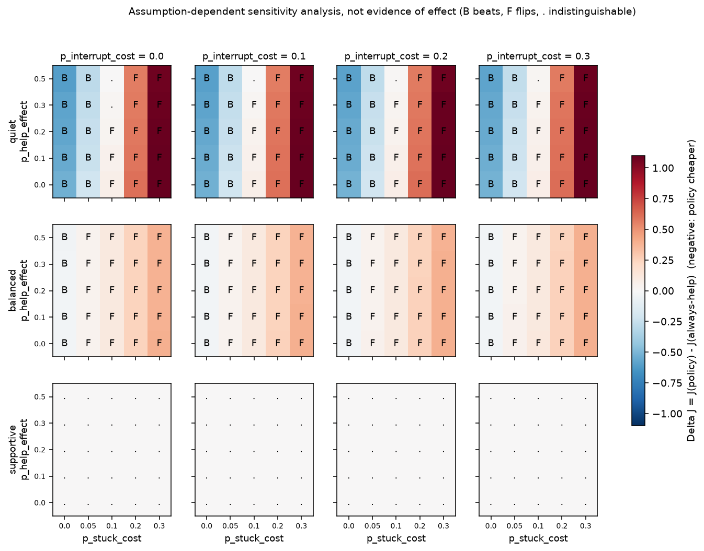

# Parametric closed-loop sensitivity (Amendment A6)

**Assumption-dependent sensitivity analysis, not evidence of effect.** Status in the results file: `assumption-dependent sensitivity analysis, not evidence of effect`. Source: `aria_pace/results/closed_loop_sensitivity.json`, produced by `python -m aria_pace.run_closed_loop`. No LLM, no real data, no locked split; frozen pooled BKT parameters, Platt calibrator and `tau` are read, never re-tuned. 100,000 simulated students per grid point, seed 20261101, common random numbers across policies.

**What it is:** a BKT-style student (latent known / unknown) who can be helped, interrupted, or left stuck, with three **assumed** parameters: `p_help_effect` (help raises every later learning chance), `p_interrupt_cost` (an interrupted student slips more on the next response), `p_stuck_cost` (a student who is wrong at a decision point and is not helped abandons with this probability). The policy's risk model equals the generator, a deliberately favourable assumption. **What it is not:** any measurement of what real students do. The numbers say how the *replay* conclusion depends on assumptions the replay cannot test.

Cost: `J = w_I * unnecessary + w_D * delay` per in-scope sequence, evaluated on the simulated (realised) trajectories; `Delta J = J(profile policy) - J(always-help)` under that profile's weights; negative = the policy is cheaper. 95% intervals are normal approximations of the paired per-sequence difference and reflect **simulation noise only**.

## Pre-registered checks (A6.6)

All three pass in `aria_pace/tests/test_closed_loop.py`: (i) with all three parameters at 0 the simulator's per-sequence unnecessary / delay / missed / fired equal the replay machinery's exactly; (ii) the first-response correctness rate matches `prior*(1-slip)+(1-prior)*guess` within Monte Carlo error; (iii) the risk table equals `BKT.score`.

## Where the policy beats always-help, and where it flips

| Profile (frozen tau) | beats | indistinguishable | flips (worse) | of 100 grid points |
|---|---|---|---|---|
| quiet (0.57) | 40 | 5 | 55 | 100 |
| balanced (0.19) | 20 | 0 | 80 | 100 |
| supportive (0.09) | 0 | 100 | 0 | 100 |

At the all-zero point (no effect of help, no interruption cost, no stuck cost) the quiet policy is cheaper than always-help (`Delta J` -0.532 per sequence) and the balanced one slightly cheaper (-0.031); the supportive policy intervenes exactly when always-help does (`Delta J` = +0.000): this reproduces the direction of the replay result. The simulator then shows how that advantage changes as the assumed cost of being left stuck grows.

Region maps (`B` beats, `F` flips, `.` indistinguishable); rows = `p_help_effect`, columns = `p_stuck_cost` [0.0, 0.05, 0.1, 0.2, 0.3]. The sign pattern for the quiet and balanced policies is the same at every `p_interrupt_cost` except in a few border cells, so the extremes are shown; every point is in the JSON.

quiet, p_interrupt_cost = 0.0:
```
p_help_effect 0.0   B  B  F  F  F
p_help_effect 0.1   B  B  F  F  F
p_help_effect 0.2   B  B  F  F  F
p_help_effect 0.3   B  B  .  F  F
p_help_effect 0.5   B  B  .  F  F
```

quiet, p_interrupt_cost = 0.3:
```
p_help_effect 0.0   B  B  F  F  F
p_help_effect 0.1   B  B  F  F  F
p_help_effect 0.2   B  B  F  F  F
p_help_effect 0.3   B  B  F  F  F
p_help_effect 0.5   B  B  .  F  F
```

balanced, p_interrupt_cost = 0.0:
```
p_help_effect 0.0   B  F  F  F  F
p_help_effect 0.1   B  F  F  F  F
p_help_effect 0.2   B  F  F  F  F
p_help_effect 0.3   B  F  F  F  F
p_help_effect 0.5   B  F  F  F  F
```

balanced, p_interrupt_cost = 0.3:
```
p_help_effect 0.0   B  F  F  F  F
p_help_effect 0.1   B  F  F  F  F
p_help_effect 0.2   B  F  F  F  F
p_help_effect 0.3   B  F  F  F  F
p_help_effect 0.5   B  F  F  F  F
```

## Approximate flip point in `p_stuck_cost` (linear interpolation of `Delta J` between grid values)

| Profile | p_interrupt_cost | p_help_effect | `p_stuck_cost` at which `Delta J` crosses 0 |
|---|---|---|---|
| quiet | 0.0 | 0.0 | ~0.089 |
| quiet | 0.0 | 0.5 | ~0.100 |
| quiet | 0.3 | 0.0 | ~0.087 |
| quiet | 0.3 | 0.5 | ~0.097 |
| balanced | 0.0 | 0.0 | ~0.022 |
| balanced | 0.0 | 0.5 | ~0.025 |
| balanced | 0.3 | 0.0 | ~0.018 |
| balanced | 0.3 | 0.5 | ~0.021 |

## Reading (conditional on the assumptions)

- The sign of the policy's advantage is decided almost entirely by `p_stuck_cost`, the assumed harm of leaving a stuck student unaided. For the quiet profile `Delta J` changes sign at about 0.087 to 0.100 per unaided wrong step; for the balanced profile at about 0.018 to 0.025. Below that the policy is cheaper than always-help, above it always-help is cheaper.
- `p_help_effect` and `p_interrupt_cost` move the numbers only a little in this model and do not change the sign pattern except in border cells (the quiet policy goes from worse to indistinguishable at `p_stuck_cost` = 0.1 when help is strong): help changes learning only for students who are still unknown, and an interruption costs one response.
- The supportive profile (`tau` = 0.09) makes **exactly the same decisions as always-help** at every grid point (interventions per sequence differ by 0.0, `Delta J` is 0.0 everywhere): every wrong response at a decision point carries a calibrated risk above 0.09 in this simulator, so the policy never stays quiet. (On the real 2009 test split it saved 3% of interventions, `RESULTS.md`; the simulator is not meant to reproduce that.)
- The replay result (fewer interventions with few missed students) therefore does not transfer to any real claim without a measurement of how costly it is to leave a student unaided for one more step; replay cannot supply that, a study with students could.



Figure: `Delta J` (policy minus always-help) over (`p_stuck_cost`, `p_help_effect`) for each profile and `p_interrupt_cost`; blue = policy cheaper, red = always-help cheaper; letters as above. **Assumption-dependent sensitivity analysis, not evidence of effect.**
