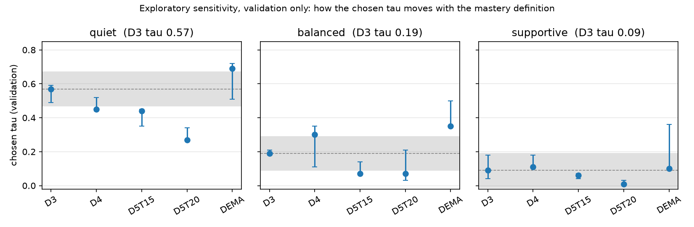

# Mastery-definition sensitivity (Amendment A4)

**Status: exploratory sensitivity (validation only; not pre-registered).** The control check (D3 reproduces `frozen_val.json`) is the only pre-registered part and it passed (Platt equal to 1e-9: True; taus equal: True). Source: `aria_pace/results/mastery_sensitivity_val.json`, produced by `python -m aria_pace.run_mastery_sens`. All numbers are on the 2009 **validation** split and are optimistic: the Platt calibrator and `tau` are chosen on the same split. No locked split was read. **Nothing here changes the frozen thresholds, the demo, or any published number.**

| Definition | In-scope sequences / students | Label rate (y=1) | BKT AUC k=3 | k=5 | k=8 |
|---|---|---|---|---|---|
| **D3** 3 correct in a row, T=10 (control = frozen definition) | 3742 / 596 | 17.2% | 0.813 [0.794, 0.833] | 0.805 [0.784, 0.828] | 0.911 [0.888, 0.931] |
| **D4** 4 correct in a row, T=10 | 2835 / 486 | 31.9% | 0.872 [0.858, 0.887] | 0.848 [0.830, 0.868] | 0.964 [0.954, 0.973] |
| **D5T15** 5 correct in a row, T=15 | 2136 / 411 | 19.3% | 0.859 [0.837, 0.879] | 0.840 [0.814, 0.866] | 0.852 [0.820, 0.878] |
| **D5T20** 5 correct in a row, T=20 | 2004 / 388 | 10.7% | 0.881 [0.857, 0.903] | 0.860 [0.830, 0.886] | 0.856 [0.822, 0.889] |
| **DEMA** EMA(alpha=0.3, ema_1=x_1) >= 0.8 for 3 consecutive opportunities, T=10 | 1388 / 389 | 75.9% | 0.894 [0.875, 0.912] | 0.935 [0.920, 0.950] | 0.990 [0.985, 0.995] |

AUC cells: point estimate [95% student-bootstrap interval].

| Definition | Profile | Chosen tau (bootstrap median, 10th-90th pct) | Shift vs D3 | Interventions/student (always-help) | Reduction vs always-help [95% CI] | Missed-help share [95% CI] |
|---|---|---|---|---|---|---|
| D3 | quiet | 0.57 (0.57, 0.49-0.59) | +0.00 | 1.35 (2.70) | 49.8% [46.5%, 53.2%] | 4.8% [3.0%, 7.0%] |
| D3 | balanced | 0.19 (0.19, 0.18-0.21) | +0.00 | 2.35 (2.70) | 13.0% [11.3%, 14.8%] | 0.0% [0.0%, 0.0%] |
| D3 | supportive | 0.09 (0.09, 0.04-0.18) | +0.00 | 2.63 (2.70) | 2.7% [1.9%, 3.5%] | 0.0% [0.0%, 0.0%] |
| D4 | quiet | 0.45 (0.45, 0.44-0.52) | -0.12 **material** | 2.39 (2.62) | 8.6% [7.0%, 10.4%] | 0.2% [0.0%, 0.7%] |
| D4 | balanced | 0.30 (0.29, 0.11-0.35) | +0.11 **material** | 2.54 (2.62) | 3.1% [2.3%, 4.1%] | 0.0% [0.0%, 0.0%] |
| D4 | supportive | 0.11 (0.11, 0.11-0.18) | +0.02 | 2.62 (2.62) | 0.2% [0.0%, 0.4%] | 0.0% [0.0%, 0.0%] |
| D5T15 | quiet | 0.44 (0.42, 0.35-0.45) | -0.13 **material** | 1.45 (2.13) | 32.2% [28.6%, 35.6%] | 5.5% [3.5%, 7.8%] |
| D5T15 | balanced | 0.07 (0.07, 0.07-0.14) | -0.12 **material** | 2.07 (2.13) | 3.1% [1.9%, 4.3%] | 0.0% [0.0%, 0.0%] |
| D5T15 | supportive | 0.06 (0.06, 0.04-0.07) | -0.03 | 2.10 (2.13) | 1.6% [0.8%, 2.5%] | 0.0% [0.0%, 0.0%] |
| D5T20 | quiet | 0.27 (0.27, 0.27-0.34) | -0.30 **material** | 1.07 (1.95) | 45.4% [41.4%, 49.6%] | 8.1% [5.0%, 12.0%] |
| D5T20 | balanced | 0.07 (0.07, 0.03-0.21) | -0.12 **material** | 1.71 (1.95) | 12.5% [10.3%, 14.9%] | 1.5% [0.0%, 3.4%] |
| D5T20 | supportive | 0.01 (0.01, 0.01-0.03) | -0.08 | 1.93 (1.95) | 1.2% [0.5%, 2.0%] | 0.0% [0.0%, 0.0%] |
| DEMA | quiet | 0.69 (0.65, 0.51-0.72) | +0.12 **material** | 2.68 (2.94) | 9.0% [7.2%, 10.9%] | 0.4% [0.1%, 0.9%] |
| DEMA | balanced | 0.35 (0.36, 0.35-0.50) | +0.16 **material** | 2.87 (2.94) | 2.4% [1.6%, 3.4%] | 0.0% [0.0%, 0.0%] |
| DEMA | supportive | 0.10 (0.19, 0.10-0.36) | +0.01 | 2.94 (2.94) | 0.2% [0.0%, 0.5%] | 0.0% [0.0%, 0.0%] |

"Material" means the chosen `tau` differs from the D3 value by more than 0.10 (pre-declared in A4.5; the window used in `stage5.py:193`).

Figure: chosen `tau` per profile under each definition (points) with the 10th-90th percentile of the student-bootstrap distribution of the chosen `tau` (bars); the grey band is +/-0.10 around the D3 control.
