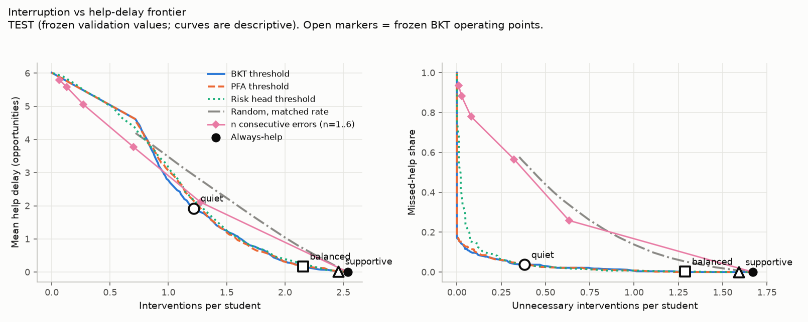
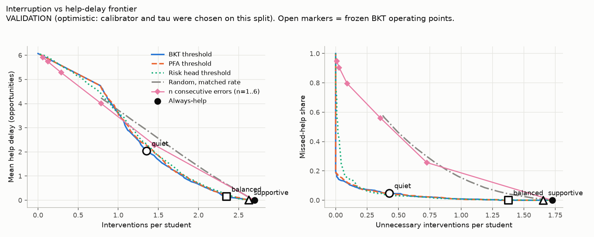
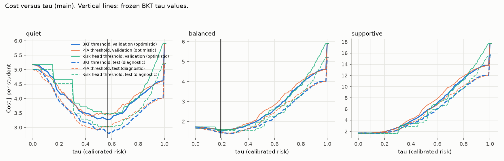
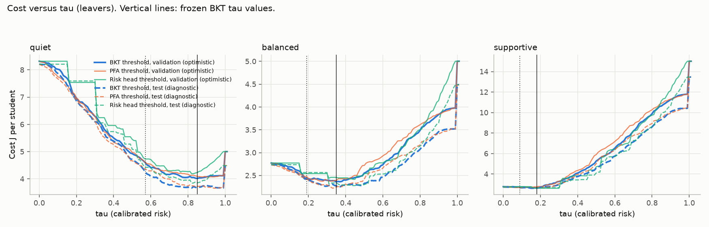
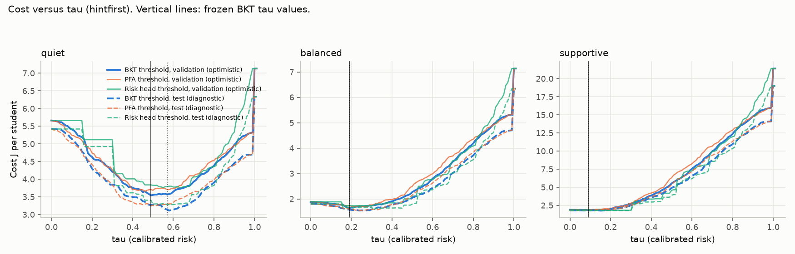

# ARIA-Pace — Results

Offline replay on ASSISTments 2009-10 skill-builder logs. Everything below is generated by `aria_pace/make_results_md.py` from the JSON files under `aria_pace/results/` (file names in each "Source" line). Protocol: `aria_pace/SPEC.md` (amendments 1 and 2, both committed before the numbers they govern).

## Headline

> **On ASSISTments 2009 logs, a BKT-threshold abstention rule roughly halves interventions when interruptions are costly, with ~5% missed help; when delayed help is costly, abstention saves little.**

What the held-out **test** students show, with the values frozen on validation (Source: `test_results.json` → `main.variants.frozen`; test = 597 students, 3468 problem-set sequences, 570 wheel-spinning):

- **Interruptions costly (quiet, 3:1).** BKT makes 1.22 interventions per student against 2.54 for always-help, **52% fewer** (95% CI for BKT [1.04, 1.41]). It misses help in 19 of 518 wheel-spinning sequences that had a help opportunity: **3.7%** (95% CI [2.2%, 5.3%]). Validation gave 4.8%, so "~5%" is the validation figure; the test point estimate is lower and its interval reaches about 5%.
- **Balanced (1:1).** 15% fewer interventions (2.15 vs 2.54); cost difference to always-help -0.236 [-0.310, -0.161]; missed help 0.2%.
- **Delayed help costly (supportive, 1:3).** 3% fewer interventions (2.46 vs 2.54); cost difference to always-help -0.025 [-0.079, 0.052], an interval that includes zero. **Abstention saves little here**; the best fixed `n`-error rule tuned for this profile is `n = 1`, which is always-help.
- **The headline holds on test for the main configuration.** It does **not** hold unchanged under every sensitivity: see "The quiet-profile tau is not stable across scope assumptions" below.

## Scope, label and data

- Data: `skill_builder_data_corrected_collapsed.csv`, sha256 in `SPEC.md`; 63,755 of 346,860 rows (18.38%) had no skill and were dropped. 64,818 (student, problem-set) sequences. Student-level split 60/20/20, seed 20261015; test = 832 students, validation = 833, train = 2498 (Source: `data_report.json`, `split.json`). No student is in more than one split (asserted in code and tested).
- Wheel-spinning label: fewer than 3 consecutive correct first-attempt responses within the first 10 opportunities, **following Wang et al. / Kai et al., attributed to Beck & Gong** (variant A, >= 10 opportunities, primary; variant B, > 10, sensitivity for the risk-score tables).
- Policy scope on test (Source: `test_results.json` → `main.scope`): 3,468 sequences from 597 students, 570 wheel-spinning, 10,907 decision points, 3,312 verified-error decision points. 518 of the 570 wheel-spinning sequences have at least one verified error at a decision point (the rest have no help opportunity and are excluded from delay and missed help). The leaver sensitivity adds 1,226 sequences.
- Verified error (primary): first-attempt wrong **and** `first_action` = 0. **The `first_action` code meanings are inferred, not documented**: 0 = answer attempt, 1 = hint request, 2 = other. Hint-first rows (code 1) and code-2 rows are excluded in the primary analysis; the sensitivity counts every first-attempt-wrong row. No risk model uses `first_action`.
- Units: all times are in **opportunities** (the file has no wall-clock time). Costs: J = w_I x (unnecessary interventions) + w_D x (opportunities of help delay), per student; weights quiet 3:1, balanced 1:1, supportive 1:3. J values are comparable within a profile, not across profiles. "Per student" means per student who has at least one in-scope sequence, summed over that student's sequences (at most one intervention per sequence).

## Test results (primary configuration)

Source: `test_results.json` → `main.variants.frozen.methods`. 95% intervals (paired bootstrap over students, 1,000 draws) are shown for BKT only; intervals on cost differences are in the next section. Mean delay includes censored (never-helped) sequences.

### Quiet (interruption : delayed help = 3 : 1), BKT tau = 0.57

| Method | Interventions / student | Unnecessary / student | Missed help (n / N, share) | Mean lead time | Mean delay | Cost J / student |
|---|---:|---:|---:|---:|---:|---:|
| BKT threshold (primary) | 1.22 [1.04, 1.41] | 0.38 [0.32, 0.45] | 19/518 = 3.7% [2.2%, 5.3%] | 4.25 | 1.92 | 2.81 [2.41, 3.27] |
| PFA threshold | 1.44 | 0.59 | 11/518 = 2.1% | 4.76 | 1.36 | 2.95 |
| Risk-head threshold | 1.30 | 0.46 | 15/518 = 2.9% | 4.22 | 1.92 | 3.03 |
| n-consecutive-errors rule, tuned (n = 2) | 1.28 | 0.63 | 134/518 = 25.9% | 5.27 | 2.11 | 3.73 |
| Three-wrong rule, untuned (n = 3) | 0.70 | 0.32 | 293/518 = 56.6% | 5.15 | 3.78 | 4.25 |
| Always-help | 2.54 | 1.67 | 0/518 = 0.0% | 6.01 | 0.00 | 5.01 |
| Random, matched to BKT's count | 1.22 | 0.64 | 171/518 = 33.2% | 4.65 | 2.91 | 4.44 |

### Balanced (1 : 1), BKT tau = 0.19

| Method | Interventions / student | Unnecessary / student | Missed help (n / N, share) | Mean lead time | Mean delay | Cost J / student |
|---|---:|---:|---:|---:|---:|---:|
| BKT threshold (primary) | 2.15 [1.86, 2.47] | 1.29 [1.11, 1.48] | 1/518 = 0.2% [0.0%, 0.6%] | 5.86 | 0.17 | 1.43 [1.24, 1.65] |
| PFA threshold | 2.09 | 1.23 | 0/518 = 0.0% | 5.80 | 0.22 | 1.42 |
| Risk-head threshold | 2.35 | 1.49 | 0/518 = 0.0% | 5.95 | 0.07 | 1.54 |
| n-consecutive-errors rule, tuned (n = 1, = always-help) | 2.54 | 1.67 | 0/518 = 0.0% | 6.01 | 0.00 | 1.67 |
| Three-wrong rule, untuned (n = 3) | 0.70 | 0.32 | 293/518 = 56.6% | 5.15 | 3.78 | 3.60 |
| Always-help | 2.54 | 1.67 | 0/518 = 0.0% | 6.01 | 0.00 | 1.67 |
| Random, matched to BKT's count | 2.15 | 1.33 | 23/518 = 4.5% | 5.55 | 0.72 | 1.95 |

### Supportive (1 : 3), BKT tau = 0.09

| Method | Interventions / student | Unnecessary / student | Missed help (n / N, share) | Mean lead time | Mean delay | Cost J / student |
|---|---:|---:|---:|---:|---:|---:|
| BKT threshold (primary) | 2.46 [2.14, 2.79] | 1.59 [1.38, 1.82] | 0/518 = 0.0% [0.0%, 0.0%] | 5.99 | 0.02 | 1.64 [1.42, 1.90] |
| PFA threshold | 2.39 | 1.52 | 0/518 = 0.0% | 5.95 | 0.06 | 1.68 |
| Risk-head threshold | 2.35 | 1.49 | 0/518 = 0.0% | 5.95 | 0.07 | 1.66 |
| n-consecutive-errors rule, tuned (n = 1, = always-help) | 2.54 | 1.67 | 0/518 = 0.0% | 6.01 | 0.00 | 1.67 |
| Three-wrong rule, untuned (n = 3) | 0.70 | 0.32 | 293/518 = 56.6% | 5.15 | 3.78 | 10.15 |
| Always-help | 2.54 | 1.67 | 0/518 = 0.0% | 6.01 | 0.00 | 1.67 |
| Random, matched to BKT's count | 2.46 | 1.60 | 3/518 = 0.7% | 5.91 | 0.14 | 1.96 |

### Paired cost differences, BKT minus baseline (negative = BKT cheaper; * = 95% interval excludes 0)

Source: `test_results.json` → `main.variants.frozen.j_diff_vs_bkt`. Units: cost J per student.

| Profile | vs always-help | vs tuned n-rule | vs untuned three-wrong | vs PFA | vs risk head | vs random (matched) |
|---|---:|---:|---:|---:|---:|---:|
| quiet (3:1) | -2.196 [-2.679, -1.750] * | -0.913 [-1.193, -0.643] * | -1.432 [-1.816, -1.053] * | -0.136 [-0.305, 0.025] | -0.216 [-0.434, -0.020] * | -1.624 [-1.953, -1.340] * |
| balanced (1:1) | -0.236 [-0.310, -0.161] * | -0.236 [-0.310, -0.161] * | -2.166 [-2.709, -1.668] * | 0.018 [-0.045, 0.072] | -0.111 [-0.168, -0.059] * | -0.513 [-0.624, -0.406] * |
| supportive (1:3) | -0.025 [-0.079, 0.052] | -0.025 [-0.079, 0.052] | -8.508 [-10.308, -6.840] * | -0.039 [-0.132, 0.039] | -0.017 [-0.107, 0.059] | -0.318 [-0.404, -0.222] * |

Reading: BKT beats always-help, the untuned three-wrong rule, and the matched-rate random policy in the quiet and balanced profiles. Against the **tuned** n-error rule it is cheaper in the quiet profile; in the other two profiles the tuned rule *is* always-help. BKT and PFA are not distinguishable in cost. BKT beats the logistic risk head in the quiet and balanced profiles on this test split.

### Validation versus test (BKT, main configuration)

Validation numbers are **optimistic**: the calibrator, `tau` and `n` were chosen on that split. Source: `val_results.json` and `test_results.json`.

| Profile | Split | BKT interventions | Always-help interventions | Reduction | BKT missed help | BKT J | Always-help J |
|---|---|---:|---:|---:|---:|---:|---:|
| quiet | validation (optimistic) | 1.35 | 2.70 | 50% | 4.8% | 3.27 | 5.18 |
| quiet | test | 1.22 | 2.54 | 52% | 3.7% | 2.81 | 5.01 |
| balanced | validation (optimistic) | 2.35 | 2.70 | 13% | 0.0% | 1.52 | 1.73 |
| balanced | test | 2.15 | 2.54 | 15% | 0.2% | 1.43 | 1.67 |
| supportive | validation (optimistic) | 2.63 | 2.70 | 3% | 0.0% | 1.70 | 1.73 |
| supportive | test | 2.46 | 2.54 | 3% | 0.0% | 1.64 | 1.67 |

Test agrees with validation in direction and approximate size. Test missed help is lower than validation, test costs are lower than validation costs for BKT and for always-help in every profile, and nothing in the test contradicts the validation ordering of methods.

## Figures











Test curves are descriptive (computed in the same single pass; they feed no choice). Open markers are the frozen BKT operating points. The "n consecutive errors" curve connects `n` = 1..6 and is not a tau sweep. The three profiles are three operating points on one BKT frontier, each chosen by its cost weights; the validation-chosen points sit close to the lowest-cost region of the test curves (see regret table below).

## The quiet-profile tau is not stable across scope assumptions (finding)

Source: `val_results.json` → `*.tau_stability_bkt` (validation, 1,000 student-bootstrap resamples; optimistic) and `frozen_val.json`.

| Configuration | Profile | Reference tau (the main-configuration frozen value) | Bootstrap median tau | 10th-90th pct | Share of resamples within 0.10 of frozen | tau range with J within 2% of min | J at reference tau | min J |
|---|---|---:|---:|---:|---:|---:|---:|---:|
| main | quiet | 0.57 | 0.57 | 0.49-0.59 | 98% | 0.48-0.60 | 3.27 | 3.27 |
| main | balanced | 0.19 | 0.19 | 0.18-0.21 | 100% | 0.18-0.21 | 1.52 | 1.52 |
| main | supportive | 0.09 | 0.09 | 0.04-0.18 | 100% | 0.00-0.12 | 1.70 | 1.70 |
| leavers | quiet | 0.57 | 0.85 | 0.77-0.87 | 0% | 0.77-0.91 | 4.60 | 4.02 |
| leavers | balanced | 0.19 | 0.35 | 0.21-0.38 | 18% | 0.28-0.40 | 2.43 | 2.36 |
| leavers | supportive | 0.09 | 0.18 | 0.14-0.19 | 100% | 0.16-0.19 | 2.71 | 2.65 |
| hintfirst | quiet | 0.57 | 0.51 | 0.49-0.58 | 98% | 0.48-0.59 | 3.57 | 3.55 |
| hintfirst | balanced | 0.19 | 0.19 | 0.18-0.21 | 98% | 0.18-0.21 | 1.65 | 1.65 |
| hintfirst | supportive | 0.09 | 0.09 | 0.04-0.18 | 100% | 0.00-0.18 | 1.86 | 1.86 |

- **Within a configuration, the quiet `tau` is stable under resampling of students**: in the main configuration 98% of resamples choose a `tau` within 0.10 of the frozen 0.57.
- **Across configurations it is not**: counting leavers as non-wheel-spinning moves the validation-chosen quiet `tau` from 0.57 to 0.85 (no bootstrap resample reaches within 0.10 of 0.57). The instability is therefore a **sensitivity to how unlabelled leavers are treated**, not sampling noise. The balanced `tau` moves from 0.19 to 0.35; supportive from 0.09 to 0.18.
- **Consequences on test** (Source: `test_results.json` → `leavers.variants`): carrying the main `tau` = 0.57 into the leaver scope gives quiet cost 4.26 vs 3.68 with the re-chosen `tau` = 0.85, while the missed-help share rises from 3.7% to 12.4% (95% CI [9.4%, 15.5%]) and lead time falls from 4.25 to 2.22 opportunities. **The "~5% missed help" figure belongs to the main configuration; under the leaver assumption that is cheapest, the quiet profile trades roughly 12% missed help for 0.87 interventions per student (always-help: 3.48).**
- With the hint-first definition the quiet `tau` moves from 0.57 to 0.49. On test the re-chosen value was slightly *worse* than the carried one (cost 3.27 vs 3.14; regret 5.0% vs 1.0%), so re-choosing on validation does not always help.

### Diagnostic: frozen tau versus the test-optimal tau

Descriptive only; test-optimal values were not used for any choice. Source: `test_results.json` → `*.sweep.methods.bkt`.

| Configuration, variant | Profile | Frozen tau | Test J at frozen tau | Test-optimal tau (diagnostic only) | Test J at that tau | Regret |
|---|---|---:|---:|---:|---:|---:|
| main, frozen | quiet | 0.57 | 2.81 | 0.58 | 2.79 | 0.022 (0.8%) |
| main, frozen | balanced | 0.19 | 1.43 | 0.24 | 1.41 | 0.028 (2.0%) |
| main, frozen | supportive | 0.09 | 1.64 | 0.15 | 1.63 | 0.018 (1.1%) |
| leavers, carried | quiet | 0.57 | 4.26 | 0.98 | 3.67 | 0.597 (16.3%) |
| leavers, carried | balanced | 0.19 | 2.41 | 0.36 | 2.25 | 0.161 (7.2%) |
| leavers, carried | supportive | 0.09 | 2.68 | 0.15 | 2.62 | 0.063 (2.4%) |
| leavers, rechosen | quiet | 0.85 | 3.68 | 0.98 | 3.67 | 0.019 (0.5%) |
| leavers, rechosen | balanced | 0.35 | 2.27 | 0.36 | 2.25 | 0.022 (1.0%) |
| leavers, rechosen | supportive | 0.18 | 2.64 | 0.15 | 2.62 | 0.017 (0.7%) |
| hintfirst, carried | quiet | 0.57 | 3.14 | 0.58 | 3.11 | 0.030 (1.0%) |
| hintfirst, carried | balanced | 0.19 | 1.58 | 0.26 | 1.54 | 0.039 (2.5%) |
| hintfirst, carried | supportive | 0.09 | 1.81 | 0.15 | 1.78 | 0.035 (2.0%) |
| hintfirst, rechosen | quiet | 0.49 | 3.27 | 0.58 | 3.11 | 0.154 (5.0%) |
| hintfirst, rechosen | balanced | 0.19 | 1.58 | 0.26 | 1.54 | 0.039 (2.5%) |
| hintfirst, rechosen | supportive | 0.09 | 1.81 | 0.15 | 1.78 | 0.035 (2.0%) |

The frozen main `tau` values lose 1-2% against the test-optimal value. Carrying the main quiet `tau` into the leaver scope loses 16% (the "leavers, carried" row), while the `tau` re-chosen on validation for that scope loses 0.5%.

## Sensitivity analyses (test, frozen values)

Source: `test_results.json` → `leavers.variants`, `hintfirst.variants`. "Carried" uses the main `tau`/`n`; "rechosen" uses values re-chosen on validation under that configuration and frozen before test.

| Configuration / tau variant | Profile | BKT tau | BKT interventions | Always-help interventions | BKT missed help | BKT J | Always-help J | Tuned n-rule J | J diff BKT - always-help |
|---|---|---:|---:|---:|---:|---:|---:|---:|---:|
| main (leavers dropped), frozen | quiet | 0.57 | 1.22 | 2.54 | 19/518 = 3.7% | 2.81 | 5.01 | 3.73 | -2.196 [-2.679, -1.750] |
| main (leavers dropped), frozen | balanced | 0.19 | 2.15 | 2.54 | 1/518 = 0.2% | 1.43 | 1.67 | 1.67 | -0.236 [-0.310, -0.161] |
| main (leavers dropped), frozen | supportive | 0.09 | 2.46 | 2.54 | 0/518 = 0.0% | 1.64 | 1.67 | 1.67 | -0.025 [-0.079, 0.052] |
| leavers as non-wheel-spinning, carried | quiet | 0.57 | 1.66 | 3.48 | 19/518 = 3.7% | 4.26 | 8.21 | 5.17 | -3.947 [-4.626, -3.318] |
| leavers as non-wheel-spinning, carried | balanced | 0.19 | 3.03 | 3.48 | 1/518 = 0.2% | 2.41 | 2.74 | 2.74 | -0.324 [-0.405, -0.248] |
| leavers as non-wheel-spinning, carried | supportive | 0.09 | 3.38 | 3.48 | 0/518 = 0.0% | 2.68 | 2.74 | 2.74 | -0.052 [-0.104, 0.017] |
| leavers as non-wheel-spinning, rechosen | quiet | 0.85 | 0.87 | 3.48 | 64/518 = 12.4% | 3.68 | 8.21 | 4.45 | -4.524 [-5.300, -3.768] |
| leavers as non-wheel-spinning, rechosen | balanced | 0.35 | 2.44 | 3.48 | 7/518 = 1.4% | 2.27 | 2.74 | 2.74 | -0.464 [-0.630, -0.303] |
| leavers as non-wheel-spinning, rechosen | supportive | 0.18 | 3.06 | 3.48 | 0/518 = 0.0% | 2.64 | 2.74 | 2.74 | -0.098 [-0.226, 0.027] |
| hint-first counted as error, carried | quiet | 0.57 | 1.39 | 2.76 | 3/570 = 0.5% | 3.14 | 5.42 | 3.68 | -2.280 [-2.816, -1.812] |
| hint-first counted as error, carried | balanced | 0.19 | 2.37 | 2.76 | 0/570 = 0.0% | 1.58 | 1.81 | 1.81 | -0.224 [-0.307, -0.144] |
| hint-first counted as error, carried | supportive | 0.09 | 2.68 | 2.76 | 0/570 = 0.0% | 1.81 | 1.81 | 1.81 | 0.007 [-0.062, 0.092] |
| hint-first counted as error, rechosen | quiet | 0.49 | 1.59 | 2.76 | 1/570 = 0.2% | 3.27 | 5.42 | 3.68 | -2.156 [-2.630, -1.732] |
| hint-first counted as error, rechosen | balanced | 0.19 | 2.37 | 2.76 | 0/570 = 0.0% | 1.58 | 1.81 | 1.81 | -0.224 [-0.307, -0.144] |
| hint-first counted as error, rechosen | supportive | 0.09 | 2.68 | 2.76 | 0/570 = 0.0% | 1.81 | 1.81 | 1.81 | 0.007 [-0.062, 0.092] |

- **Leavers as non-wheel-spinning** raises the unnecessary share of every policy (more sequences are counted as not needing help) and raises always-help's cost most; BKT's advantage over always-help grows (quiet: cost 4.26 vs 8.21).
- **Hint-first counted as error**: the quiet BKT policy makes 1.39 interventions per student against 2.76 for always-help (50% fewer) with 3/570 wheel-spinning sequences missed (0.5%). More sequences have a help opportunity (the denominator is larger), which lowers missed help.

## Risk-score quality (validation only)

These are **validation** numbers (hyperparameters of PFA, BKT and the head were chosen on this split by next-response log-loss; they are optimistic). The test split was used only for the policy evaluation above; **AUC and calibration of the risk scores were not computed on test**, and the test lock prevents adding them without breaking the one-evaluation rule. Variant A label. Source: `baselines_val.json`, `riskhead_val.json`. Calibration is `n/a` for 0/1 methods.

| k | Method | N | Base rate | AUC [95% CI, student bootstrap] | Brier | ECE (10 equal-mass bins) | Calibration intercept / slope |
|---|---|---:|---:|---:|---:|---:|---:|
| 3 | BKT | 3742 | 17.2% | 0.813 [0.794, 0.833] | 0.117 | 0.041 | -0.40 / 0.94 |
| 3 | PFA | 3742 | 17.2% | 0.805 [0.785, 0.824] | 0.119 | 0.048 | -0.34 / 1.04 |
| 3 | Three-wrong rule (0/1) | 3742 | 17.2% | 0.666 [0.642, 0.690] | n/a | n/a | n/a |
| 3 | Always-help (0/1) | 3742 | 17.2% | 0.500 (constant score) | n/a | n/a | n/a |
| 3 | Risk head (logistic regression) | 3742 | 17.2% | 0.799 (CI not computed) | not computed | not computed | not computed |
| 5 | BKT | 1769 | 36.4% | 0.805 [0.784, 0.828] | 0.170 | 0.029 | -0.03 / 0.95 |
| 5 | PFA | 1769 | 36.4% | 0.800 [0.776, 0.823] | 0.172 | 0.031 | -0.13 / 1.00 |
| 5 | Three-wrong rule (0/1) | 1769 | 36.4% | 0.622 [0.597, 0.650] | n/a | n/a | n/a |
| 5 | Always-help (0/1) | 1769 | 36.4% | 0.500 (constant score) | n/a | n/a | n/a |
| 5 | Risk head (logistic regression) | 1769 | 36.4% | 0.802 (CI not computed) | not computed | not computed | not computed |
| 8 | BKT | 856 | 75.2% | 0.911 [0.888, 0.931] | 0.105 | 0.029 | 0.16 / 0.75 |
| 8 | PFA | 856 | 75.2% | 0.906 [0.882, 0.929] | 0.105 | 0.024 | -0.04 / 0.64 |
| 8 | Three-wrong rule (0/1) | 856 | 75.2% | 0.631 [0.592, 0.668] | n/a | n/a | n/a |
| 8 | Always-help (0/1) | 856 | 75.2% | 0.500 (constant score) | n/a | n/a | n/a |
| 8 | Risk head (logistic regression) | 856 | 75.2% | 0.902 (CI not computed) | not computed | not computed | not computed |

The logistic risk head did not beat PFA or BKT (mean validation AUC 0.834 vs BKT 0.843 and PFA 0.837; margin -0.0083, paired bootstrap CI [-0.0164, -0.0008]; required +0.005), so by the pre-declared rule BKT is the primary risk score. The head's coefficients are in `riskhead_val.json`. AUC differs by label prevalence and population at each `k`; values are not comparable across `k`, and much of the AUC at k = 8 reflects the three-in-a-row mechanics with two opportunities left.

## Limitations

1. **Offline replay.** The logs contain no tutor interventions. Nothing here shows what a student would have done if interrupted or helped.
2. **"Unnecessary" is a proxy.** It means: the sequence later mastered within 10 opportunities without logged help. A student may have mastered because of unlogged help, an interruption might have helped or harmed, and a wheel-spinning sequence might not have benefited from earlier help.
3. **No learning-gain claim.** Lead time and help delay are counts of opportunities in logged data, not learning outcomes.
4. **The SymPy answer-verification layer from the demo is not evaluated.** Replay uses each log's own first-attempt correctness as ground truth.
5. **Grade level is unknown.** The sources for the 2009-10 file do not state it; no grade claim is made.
6. **`first_action` meanings are inferred** from cross-tabulation, not documented. They define the primary "verified error" (codes 1 and 2 excluded) and nothing else.
7. **No clinical labels and no clinical claims.** The three profiles are cost settings. Nothing here concerns ADHD, math anxiety, or any clinical or demographic group, and no such claim should be drawn from it.
8. **Selection.** Sequences where the student left before 10 opportunities without mastering have no label; the primary analysis drops them (1291 such sequences at k = 3 on validation) and the leaver sensitivity treats them as non-wheel-spinning. Neither is correct; the truth is unobserved. Mastered sequences are labelled 0 by construction.
9. **Single dataset, single split.** One public dataset from one platform and one student-level split; no external replication.
10. **Optimistic validation.** The Platt calibrator, `tau` and `n` share the validation split, so all validation costs are optimistic; test is the unbiased figure for the frozen values (it is a single draw of 597 students and carries the intervals shown).
11. **Hyperparameter and design choices** (profile ratios 3:1, 1:1, 1:3; at most one intervention per sequence; decision points 3 to 9; Platt recalibration) were fixed by the owner/protocol, not tuned for performance, and other choices could change the numbers.
12. **Label definition.** The wheel-spinning label follows Wang et al. / Kai et al.; Beck & Gong's primary text was not read. The risk-score AUC is shown for both variants in `baselines_val.json`; the policy evaluation uses variant A only.
13. **Related work.** A profile-conditioned abstention frontier was not found published by the searches in `docs/aria_pace/LITERATURE.md`, which were limited and non-systematic; the closest work, DICE (arXiv 2610.04825), is simulation-based. Components used here (early wheel-spinning prediction, risk-triggered help, abstention-style thresholds) are not new.

## Reproducing

From the repository root, with `aria_pace/requirements.txt` installed and the dataset downloaded as in `docs/aria_pace/DATA.md`:

```
python -m pytest aria_pace/tests            # unit tests
python -m aria_pace.run_baselines           # Stage 3: data_report, split, label_counts, baselines_val
python -m aria_pace.run_policy              # Stage 4: riskhead_val, policy_val
python -m aria_pace.freeze_val              # Stage 5a: frozen_val.json (+ .sha256), val_results.json
python -m aria_pace.run_test                # Stage 5b: test_results.json; refuses if results/TEST_LOCK exists
python -m aria_pace.run_test --verify       # recompute test and compare, writes nothing (for third parties; NOT executed by the author: it re-reads the test split)
python -m aria_pace.report                  # figures
python -m aria_pace.make_results_md         # this file
```

Git history shows the order: SPEC amendment 2, then `frozen_val.json`, then the test results. Two consecutive runs of Stages 3 and 4 gave byte-identical JSON, and the validation freeze path is the code path used on test.

## Claim-to-file map

| Claim | File |
|---|---|
| Counts, label rate, exclusions | `label_counts.json`, `data_report.json`, `test_results.json` (`*.scope`) |
| Risk-score AUC and calibration (validation) | `baselines_val.json`, `riskhead_val.json` |
| Frozen taus, `n`, calibrators | `frozen_val.json`, `frozen_val.sha256` |
| Validation policy results (optimistic), tau stability | `val_results.json` |
| Test policy results, CIs, cost differences, sweeps | `test_results.json`, `TEST_LOCK` |
| Figures | `aria_pace/figures/*.png` |
