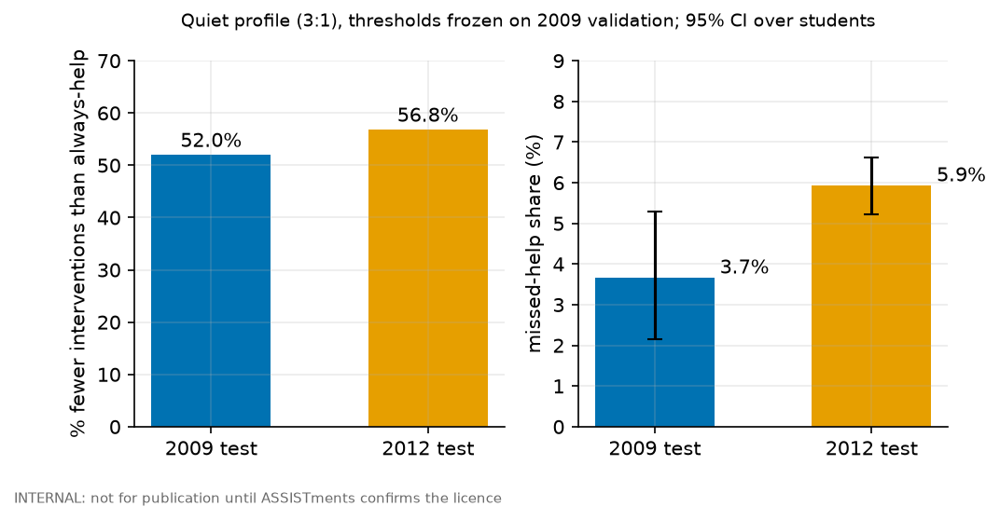
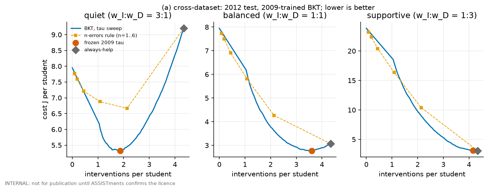
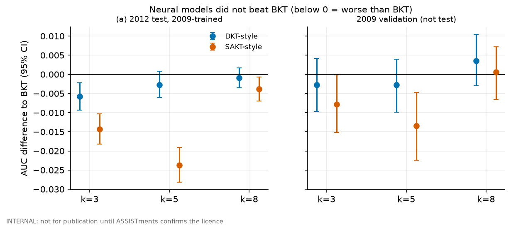
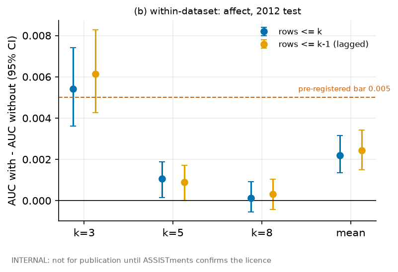

> **INTERNAL: not for publication until ASSISTments confirms the licence.** Licence confirmation from ASSISTments is pending. Do not present, post or share outside the team until it arrives.

# ARIA-Pace: knowing when *not* to step in

**Headline (a, cross-dataset). Quiet profile (3:1), thresholds frozen on 2009 validation, applied unchanged to both test sets.**

| | 2009 test | 2012 test |
|---|---|---|
| Fewer interventions than always-help | **52%** | **56.8%** |
| Help missed for students who needed it | **3.7%** | **5.9%** |

- **Miss rate rose on the new dataset** (3.7% to 5.9%; the 95% intervals overlap slightly, so the rise is suggestive rather than settled). The 2009-trained risk scores drift on 2012: calibration intercept -0.65, slope 0.73 at k=3. This is the likely reason for the higher miss rate; we did not isolate it.
- **Supportive profile (1:3)** is slightly worse than always-help on 2012 (cost difference +0.056 per student, 95% CI +0.011 to +0.103; it saves only 4% of interventions). On 2009 the difference was not distinguishable from zero.
- **Neural models did not beat BKT.** DKT-style and SAKT-style (single-skill simplifications) had lower AUC than BKT on the 2012 test at every k (point estimates; intervals exclude 0 only for DKT-style at k=3 and SAKT-style at all k) (DKT-style -0.006 / -0.003 / -0.001; SAKT-style -0.014 / -0.024 / -0.004 at k=3/5/8). On the 2009 side the comparison was run on validation only, where neither was promoted.
- **(b, within-dataset) Affect adds almost nothing.** Adding detector-predicted affect (rank-transformed, version unverified) changed AUC by +0.0022 (95% CI +0.0013 to +0.0031) on the 2012 test, below the pre-registered 0.005 bar; the lagged version gives +0.0024.

**Read with care.** Replay of logged data, not a classroom. "Unnecessary" is a proxy (the student later reached mastery anyway). Grade level unverified. No learning-gain claim; no clinical claim.

Further figures

---
**Speaker notes**

- Two datasets, never pooled: (a) is 2009-trained and frozen, evaluated on the locked 2012 test (4,651 students); (b) trains and selects on 2012 train/validation and evaluates once on the same test.
- Exploratory, not pre-registered, not on the slide: the plain windowed logistic head scored above BKT in AUC on the 2012 test at k=3 and k=5 (+0.008 and +0.013) and below at k=8 (-0.004). BKT remains the primary score; this is a lead, not a result.
- Affect replication: the same comparison on 2012 validation gave +0.0022 (CI +0.0012 to +0.0031); the test gave +0.0022. Both are within-2012, so "replicated" means validation to test, not a third dataset. The k=3 gain (about +0.005) is the only one near the bar.
- Quiet-profile 2009 numbers come from the earlier single 2009 test evaluation (`results/TEST_LOCK`); 2012 from `results/TEST_LOCK_2012`.
- Do not describe any of this as improving learning or as detecting a student's state.

---
**Traceability** (every number above is generated by `aria_pace/make_slide.py` from these files)

| Number | Source |
|---|---|
| 52% / 3.7% (2009 test) | `results/test_results.json`: main.variants.frozen.methods.bkt.quiet, always_help.quiet |
| 56.8% / 5.9% (2012 test) | `results/test_results_2012.json`: a_cross_dataset.policy.main.variants.frozen.methods |
| calibration -0.65 / 0.73 | `results/test_results_2012.json`: a_cross_dataset.risk.results.variantA_k3.bkt.calibration_line |
| supportive cost difference | `results/test_results_2012.json`: ...j_diff_vs_bkt.supportive.always_help |
| neural vs BKT | `results/test_results_2012.json`: a_cross_dataset.risk.paired_vs_bkt; 2009 validation: `results/dkt_val.json`, `results/sakt_val.json` |
| affect | `results/test_results_2012.json`: b_within_dataset_affect.mean_over_k, paired_with_minus_without; validation: `results/affect_val.json` |
| frozen thresholds | `results/frozen_val.json` (sha in `results/frozen_v2.json`) |
